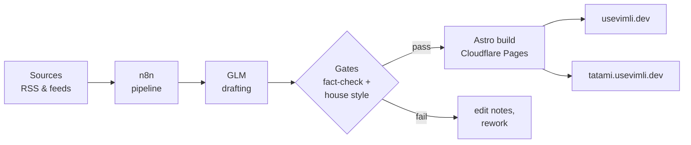

# Rack'n Roll

> A self-hosted home lab and two automated newsrooms — infrastructure as code, pipelines as
> code, everything reproducible from the repos in this org.

## Live

| | |
|---|---|
| 📰 [usevimli.dev](https://usevimli.dev) | Tech newsroom — bilingual (TR/EN) daily briefings and articles |
| 🥊 [tatami.usevimli.dev](https://tatami.usevimli.dev) | Combat-sports newsroom — Turkish-language fight news |

## The pipeline

## What lives here

| Repo | What it is |
|---|---|
| [`homelab`](https://github.com/racknroll/homelab) | The lab itself: hypervisor, containers, services, CI, monitoring — declared, applied and tested from this one repo |
| [`usevimli.dev`](https://github.com/racknroll/usevimli.dev) | Tech newsroom — content pipeline, site and automation |
| [`tatami.usevimli.dev`](https://github.com/racknroll/tatami.usevimli.dev) | Combat-sports newsroom — same pipeline, same discipline |

## How it works

- **Newsrooms** — an [n8n](https://n8n.io) pipeline collects sources, drafts stories with
  GLM, runs fact-check and house-style gates, then publishes. Sites build and deploy on
  every push; every story carries its edit notes with it.
- **Infrastructure** — services, versions and configuration live in the `homelab` repo.
  Nightly jobs converge the lab to the declared state; CI runs on self-hosted runners
  inside the lab, not on borrowed machines.
- **Operations** — least-privilege tokens and deploy keys, no secrets in git, snapshots
  before every change, alerts on every failure.

## Principles

1. If it is not in the repo, it does not exist.
2. Automation writes, humans approve.
3. Test before it matters, not after.
